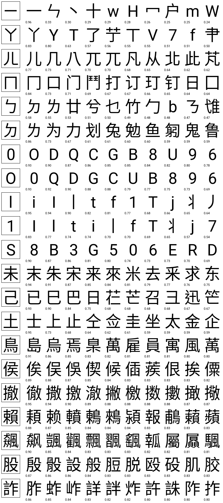

# zh-glyph-similarity：繁中、簡中、注音、數字、英文的字形相似度總表

詐騙簡訊會用形似字、注音符號、數字冒充字母（Ca11、L1ne）來躲避關鍵字比對。這個專案把五類字元放進同一張方陣，用**同一套渲染流程與同一個公式**算出每一對字元「在手機上看起來有多像」，讓整張表的分數可以互相比較。

目前只算**字形相似**。音似（同音、近音、注音拼寫）不在本表範圍。

## 範圍

字元索引共 16,203 字，順序固定（`data/charset.tsv` 的列號就是矩陣的列與欄），是下列字集的聯集：

| 類別 | 來源 | 字數 |
|---|---|---|
| 注音符號 | U+3105–U+3129 的 37 個符號＋5 個聲調符號 | 42 |
| 阿拉伯數字、英文字母 | ASCII 0–9、A–Z、a–z | 62 |
| 繁體中文編碼 | Big5 第一字面（常用）＋第二字面（次常用） | 5,401 ＋ 7,652 |
| 簡體中文編碼 | GB2312 一級＋二級 | 3,755 ＋ 3,008 |
| 臺灣官方字表 | 教育部《常用國字標準字體表》＋《次常用國字標準字體表》 | 4,808 ＋ 6,343 |
| 中國官方字表 | 《通用规范汉字表》一、二、三級 | 3,500 ＋ 3,000 ＋ 1,605 |

重疊的字只算一次。為什麼取聯集：
- 兩套編碼與兩份官方字表各有對方沒有的字。例如 GB2312 的部首部件（冂、匚、勹、卩、厶、凵、攵）正是注音 ㄇ、ㄈ、ㄅ、ㄗ、ㄙ、ㄩ、ㄆ 的字源，《通用规范汉字表》卻沒有收；《通用规范汉字表》三級的人名、地名用字則多半不在 GB2312。
- 罕用字留在表裡反而有用：詐騙也可能挑罕用的形似字。

`charset.tsv` 的 `sets` 欄記錄每個字屬於哪些字集（`big5_1`、`moe_1`、`tgh_3` 等）。只需要部分字集時，直接取矩陣的子集即可，不用重算。字集的前 15,537 字（Big5 ∪ GB2312）與第一版相同、位置不變，`python3 -m glyphsim.charset --no-lists` 可重建第一版字集。

## 方法

1. **依平台的字型堆疊渲染**（`stacks.json`）：每個字使用堆疊中第一個收錄它的字型，模擬手機的字型備援。所有字用同一個畫布（64×64）、同一個字級（56 px）、同一條基線，所以窄的「l」與全形的「一」保留真實的相對大小與位置。
2. **計算相似度（`chamfer_st`）**：
   - 基礎是對稱 chamfer 距離：把筆畫（墨色 ≥50%）視為點集，計算 A 的筆畫到 B 最近筆畫的平均距離，再與反方向平均。
   - 加上寬度容許：任一字可左右拉伸 0.8、0.89、1.0、1.12、1.25 倍，取最像的結果，每拉伸 |ln s| 加 0.5 px 的距離作為代價。
   - 相似度 = `exp(-距離 / 3 px)`。全部格子都用這同一個公式。
3. **評估**：用已知的形似字對檢查排名（Recall@k、MRR、對隨機字對的 AUC）。

### 為什麼要容許寬度差異

最初版本只用 chamfer 距離，結果「0」最像的字依序是 D、B、8，O 只排第 4。原因是 Roboto 的 0 寬 25 px、O 寬 32 px，整圈外框都偏移了；8 和 0 一樣寬，外框幾乎重疊，只多了中間一筆，所以 chamfer 反而判 8 比較像。這和人眼的判斷相反：人看字形會容忍寬窄差異。加入寬度容許後，0 和 O 互為第一名（0.93），8 退到第 7。

我們也試過「洞數不同就扣分」（0 有 1 個封閉區域、8 有 2 個），但在 64 px 下，複雜漢字的封閉區域數不穩定，漢字形近字的前 10 名命中率從 98% 掉到 88%，所以沒有採用。完整的參數比較在 `experiments/`。

### 平台字型

| 堆疊 | 拉丁字母、數字 | 漢字、注音 | 發布方式 |
|---|---|---|---|
| `android_aosp_zh_tw` | Roboto | Noto Sans CJK TC（缺字用 SC） | 字型為 SIL OFL 1.1，直接發布計算結果 |
| `ios_zh_tw` | SF Pro（SFNS，opsz 17） | 蘋方 TC（缺字用 SC） | **只提供程式**，請在自己的 Mac 上產生，原因見 `NOTICE.md` |

Android 品牌眾多（Samsung、小米、OPPO、vivo 各有自家字型），目前以 AOSP 預設的 Noto Sans CJK＋Roboto 作為 Android 基準。字型對結果的影響見下方「字型敏感度」。

## 結果（Android 基準，`chamfer_st`）

| 驗證集 | 字對數 | R@1 | R@5 | R@10 | MRR | AUC |
|---|---|---|---|---|---|---|
| Unicode confusables（UTS #39 v18，同 skeleton） | 92 | 0.511 | 0.804 | 0.891 | 0.644 | 0.941 |
| 自建字對（`groundtruth/curated_pairs.tsv`） | 140 | 0.507 | 0.871 | 0.929 | 0.665 | 0.875 |
| pycorrector same_stroke（簡中，共用部件） | 2,818 | 0.033 | 0.093 | 0.136 | 0.067 | 0.622 |

自建字對依類型的 R@10：漢字形近字 0.975、數字與字母 1.000、注音與其字源漢字 0.825、英文與漢字 0.833。

與最初版本（純 chamfer，15,537 字）相比：自建字對 R@5 從 0.850 升到 0.871，數字與字母的 R@1 從 0.357 升到 0.500，Unicode 字對的 AUC 從 0.908 升到 0.938。

說明：
- 模糊後的影像餘弦相似度（`blurcos`）也試過，整體不如 chamfer 系列。
- pycorrector 的 same_stroke 是拼字檢查用的混淆集，收的是「共用部件」的字（例如 丁／盯、王／琴），整體字形並不像。本表衡量的是整個字看起來像不像，所以這組分數低是預期中的，只列出供參考。
- 自建字對中「注音與其字源漢字」（例如 ㄉ／刀）有些在字型設計上已經差很多，相似度低反映的是實際字形。
- 自建字對由本專案整理，不是外部標註。最可靠的驗證方式是請多人對字對評分，這是後續工作。



### iOS（在 Mac 上產生，表本身不公開）

| 驗證集 | 字對數 | R@1 | R@5 | R@10 | MRR | AUC |
|---|---|---|---|---|---|---|
| Unicode confusables | 92 | 0.761 | 0.935 | 0.957 | 0.849 | 0.959 |
| 自建字對 | 140 | 0.500 | 0.871 | 0.907 | 0.654 | 0.848 |
| pycorrector same_stroke | 2,818 | 0.031 | 0.087 | 0.127 | 0.064 | 0.607 |

蘋方 TC 缺的 238 字（多為《通用规范汉字表》新增字）由蘋方 SC 畫出。

### 可重現性

同一套程式在雲端（Linux，OpenBLAS）與 MacBook Air M2（Accelerate）上算出的 Android 表，三組驗證分數完全相同。發布檔的位元組不完全相同，推測是兩邊矩陣運算的浮點加總順序不同，使少數格子在換算成 0～255 時相差 1。Releases 中的檔案以 `manifest_*.json` 記錄的 SHA-256 為準。


## 字型敏感度與跨平台差異

用兩組比較檢查字型的影響：

| 比較 | 字集 | 漢字數 | 隨機字對 Spearman | Pearson | A 判為很像（≥0.85）的字對，B 仍 ≥0.80 | 這些字對在 B 的前 50 名 | 前 10 名重疊度（Jaccard） |
|---|---|---|---|---|---|---|---|
| Android（Noto）對圓體 jf open 粉圓 2.1 | 15,537 字版本 | 8,564 | 0.926 | 0.951 | 98.0% | 94.2% | 0.34 |
| Android（Noto＋Roboto）對 iOS（蘋方＋SF Pro） | 16,203 字 | 16,099 | 0.931 | 0.952 | 97.7% | 93.0% | 0.38 |

- 粉圓只收錄約 8,600 字，所以第一組只比較兩種字型都畫得出的漢字。
- 第二組的「很像的字對」取自隨機 4,000 個漢字各自的前 10 名（`glyphsim.compare --sim-a --sim-b`，共 18,338 對）。這些字對在 iOS 的排名中位數為 6，66% 仍在前 10 名。
- 第 1 名相同的比例（Android 對 iOS）：漢字 45%、注音 52%、數字與英文 74%。
- 差異多半來自字型設計。例如 Noto 把「刂」畫在字框右半邊（和它在「到」「別」中的位置相同），所以 Android 表中它的鄰近字是右側有直筆的字（习、书、泪）；在 iOS 表中則是同樣細長的丬、阝、卩。

結論：**「哪些字很像」受字型影響小，「確切排名」受字型影響大**。使用本表時建議依分數門檻取候選字，不要依賴第幾名；若要同時涵蓋多個平台，可對各平台的表取最大值。

## 總表在哪裡、有多大

「總表」是 16,203 × 16,203 的完整方陣，共 2 億 6,254 萬格，每格 1 byte（分數 × 255 取整數）：

| 檔案 | 大小 | 內容 |
|---|---|---|
| `sim_<表名>.npy`（計算時產生） | 263 MB | 完整方陣，NumPy 格式，可直接 `np.load(..., mmap_mode="r")` |
| `matrix_<表名>.triu.u8.xz`（Releases） | 90 MB | 方陣對稱，只存上三角再以 xz 壓縮；用 `glyphsim.load.load_matrix()` 還原，與 `.npy` 逐格相同 |
| `neighbors_<表名>.tsv`（Releases） | 26 MB | 每個字最像的前 50 字，方便直接閱讀，不是完整方陣 |
| `manifest_<表名>.json`（Releases） | 2 KB | 參數、渲染設定、檔案 SHA-256 |

完整方陣與鄰近字表放在本 repo 的 **Releases**，不放在 git 歷史裡。若每格改存 32 位元浮點數，完整方陣會是 1 GB；0～255 的精度（約 0.004）已足夠排序與設門檻。

## 使用方式

```bash
python3 -m venv .venv && .venv/bin/pip install -r requirements.txt
OUT=/外接硬碟/路徑 PYTHON=.venv/bin/python scripts/run_stack.sh android_aosp_zh_tw   # 任何系統，自動下載字型
OUT=/外接硬碟/路徑 PYTHON=.venv/bin/python scripts/run_stack.sh ios_zh_tw            # 只能在 macOS 上執行
.venv/bin/python -m glyphsim.compare /外接硬碟/路徑/topk_android_aosp_zh_tw_chamfer_st.npz /外接硬碟/路徑/topk_ios_zh_tw_chamfer_st.npz \
  --sim-a /外接硬碟/路徑/sim_android_aosp_zh_tw_chamfer_st.npy --sim-b /外接硬碟/路徑/sim_ios_zh_tw_chamfer_st.npy
.venv/bin/python -m glyphsim.export android_aosp_zh_tw_chamfer_st --data /外接硬碟/路徑 --outdir /外接硬碟/路徑/release
```

- `data/charset.tsv` 已隨 repo 提供；若刪除它，`run_stack.sh` 會先下載官方字表再重建。
- 在 MacBook Air M2 上，一張表約 1 分鐘，匯出約 2 分鐘；計算時需要約 2.5 GB 記憶體。
- 只要用表、不想自己算：到 Releases 下載 `charset.tsv` 與 `matrix_*.triu.u8.xz` 或 `neighbors_*.tsv`。

```python
from glyphsim.load import load_charset, load_matrix
chars = load_charset("charset.tsv")
sim = load_matrix("matrix_android_aosp_zh_tw_chamfer_st.triu.u8.xz", len(chars))   # 16203 x 16203
sim[chars.index("0"), chars.index("O")] / 255   # 0.93
```

## 授權

- 程式碼（`glyphsim/`、`scripts/`、`experiments/*.py`）：MIT，見 `LICENSE`。
- 資料（`data/charset.tsv`、Releases 中的相似度表、`groundtruth/curated_pairs.tsv`、評估結果）：CC BY 4.0，見 `LICENSE-DATA`。使用時請註明出處。
- 不隨專案散布的第三方資料與字型（Unicode confusables、pycorrector、官方字表、Noto、Roboto、Apple 字型），以及不提供 iOS 表的原因，見 `NOTICE.md`。
