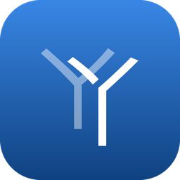
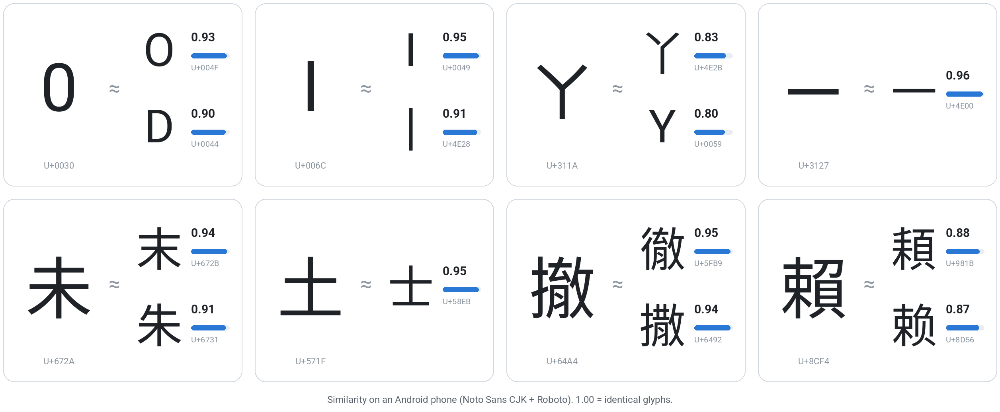
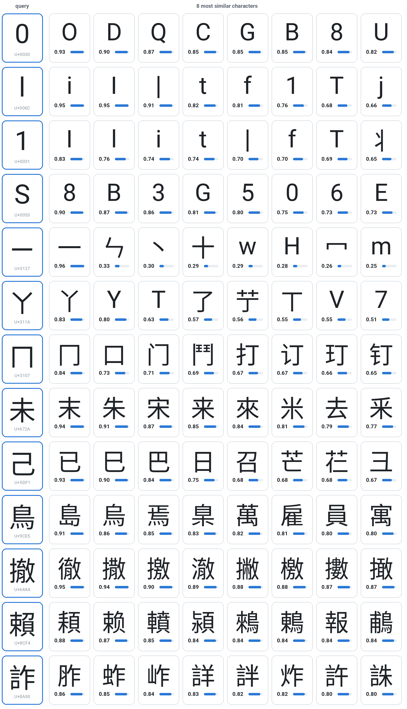
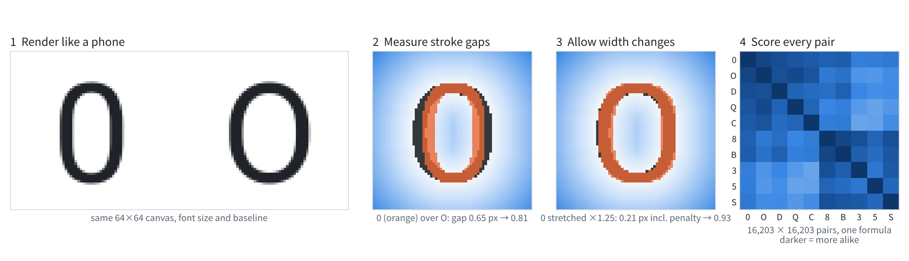
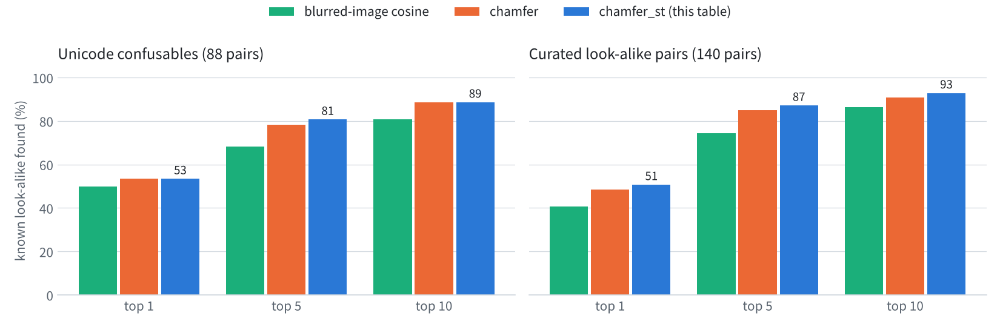
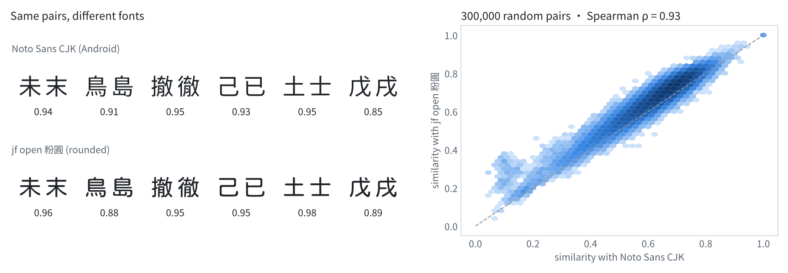

<p align="center">
  
</p>

<h1 align="center">zh-glyph-similarity</h1>

<p align="center">
  <b>在手機上，哪些字看起來很像？</b><br>
  涵蓋繁體中文、簡體中文、注音符號、阿拉伯數字與英文字母，共 16,203 字的字形相似度總表。<br>
  每一對字都用同一個公式、以真實手機字型畫出的字形計算。
</p>

<p align="center">
  <a href="https://github.com/junwei940302/zh-glyph-similarity/releases"></a>
  <a href="#字集"></a>
  <a href="#字集"></a>
  <a href="#字型與平台"></a>
  <br>
  <a href="#快速開始"></a>
  <a href="LICENSE"></a>
  <a href="LICENSE-DATA"></a>
  <a href="https://github.com/junwei940302/zh-glyph-similarity/releases"></a>
</p>

<p align="center">
  <a href="#快速開始">快速開始</a> ·
  <a href="#運作方式">運作方式</a> ·
  <a href="#驗證結果">驗證結果</a> ·
  <a href="#資料檔">資料檔</a> ·
  <a href="https://github.com/junwei940302/zh-glyph-similarity/releases">下載</a> ·
  <a href="README.md">English</a>
</p>

<p align="center">
  <picture>
    <source media="(prefers-color-scheme: dark)" srcset="docs/assets/hero-dark.png">
    <source media="(prefers-color-scheme: light)" srcset="docs/assets/hero-light.png">
    
  </picture>
</p>

詐騙簡訊常用長得一樣的字躲過關鍵字過濾：把 `LINE` 寫成 `L1NE`、用注音 `ㄚ` 代替 `丫`、用罕用字 `頛` 代替 `賴`。本專案計算 16,203 字中任兩個字在手機上看起來有多像，讓過濾器、正規化程式與測試資料都能把這類替換考慮進去。

## 特色

- **每一對字、同一個公式。** 16,203 × 16,203，約 2.6 億個分數全部用同一套方法算出，表中任何位置的 0.90 意義都相同。
- **照手機的方式畫字。** 逐字依字型備援順序挑字型，同一張畫布、同一字級、同一條基線。公開 Android 表；iOS 表可在自己的 Mac 上產生。
- **容許寬窄差異，不容許形狀差異。** 以筆畫距離為基礎，允許字形稍微拉寬或壓窄，因此 `0` 與 `O` 幾乎相同（0.93），`8` 則不會排到最前面。
- **以已知形近字驗證。** 使用 Unicode confusables、自建形近字對、第二套字型，以及 Android 與 iOS 的比較。
- **容易使用。** `pip install`、三行 Python、命令列工具，或直接讀 TSV。
- **開放、可重現。** 只用開源字型、字表版本固定、每個檔案附 SHA-256。程式採 MIT，資料採 CC BY 4.0。

## 快速開始

```bash
pip install "git+https://github.com/junwei940302/zh-glyph-similarity"
```

```python
from glyphsim import GlyphSim

gs = GlyphSim.from_release()      # 第一次會下載總表（約 90 MB），之後從快取讀取

gs.similarity("0", "O")           # 0.933
gs.similarity("ㄚ", "丫")          # 0.831
gs.neighbors("賴", k=3)            # [('頛', 0.878), ('赖', 0.867), ('轒', 0.847)]
gs.lookalikes("l")                # ['i', 'I', '丨']   （分數 >= 0.85）
```

命令列：

```console
$ glyphsim neighbors ㄚ -k 3
  1  丫  U+4E2B  0.831
  2  Y  U+0059  0.800
  3  T  U+0054  0.627

$ glyphsim sim 未 末
0.941
```

第一次呼叫會把總表快取在 `~/.cache/zh-glyph-similarity`（可用環境變數 `GLYPHSIM_CACHE` 改位置），之後每次約 0.2 秒載入。

<details>
<summary><b>不安裝任何套件</b></summary>

從 [Releases](https://github.com/junwei940302/zh-glyph-similarity/releases) 下載 `charset.tsv` 與 `neighbors_android_aosp_zh_tw_chamfer_st.tsv`，用任何工具讀取：

```python
import pandas as pd

nb = pd.read_csv("neighbors_android_aosp_zh_tw_chamfer_st.tsv", sep="\t")
nb[nb.char == "賴"].head(3)
#  char codepoint  rank neighbor neighbor_codepoint   score
#     賴    U+8CF4     1        頛             U+981B  0.8793
#     賴    U+8CF4     2        赖             U+8D56  0.8683
#     賴    U+8CF4     3        轒             U+8F52  0.8466
```

</details>

## 用途

**強化關鍵字過濾。** `pattern()` 把關鍵字轉成正規表示式，連形近字的寫法也能比對：

```python
import re

rx = re.compile(gs.pattern("LINE", min_score=0.8))   # 'L[Ili丨1ft][NH]E'
bool(rx.search("加L1NE領飆股"))                       # True
bool(rx.search("加LlNE好友"))                         # True
```

其他用途：
- **文字正規化**：分類前先把罕用形近字換回它模仿的常用字。
- **建立對抗測試集**：把字換成高分形近字，觀察模型表現下降多少。
- **OCR 或錯字更正**：依字形接近程度排序候選字。

## 範例

幾個字在 Android 表中最像的字：

<p align="center">
  <picture>
    <source media="(prefers-color-scheme: dark)" srcset="docs/assets/gallery-dark.png">
    <source media="(prefers-color-scheme: light)" srcset="docs/assets/gallery-light.png">
    
  </picture>
</p>

## 運作方式

<p align="center">
  <picture>
    <source media="(prefers-color-scheme: dark)" srcset="docs/assets/how-it-works-dark.png">
    <source media="(prefers-color-scheme: light)" srcset="docs/assets/how-it-works-light.png">
    
  </picture>
</p>

1. **照手機的方式畫字。** 每個字用平台字型備援清單中第一個收錄它的字型畫出，畫布 64 × 64、字級 56 px、基線一致。窄的 `l` 與全形的 `一` 都保有實際的大小與位置。
2. **量筆畫距離。** 把筆畫當成點集，用對稱 chamfer 距離計算一個字的每個筆畫像素離另一個字最近筆畫的平均距離。
3. **容許寬窄變化。** 任一個字可以水平縮放 0.8～1.25 倍，取最吻合的結果，再加上 0.5 px × |ln s| 的懲罰。少了這一步，`O` 在 `0` 的鄰近字中只排第 4，落後 `D`、`B`、`8`：兩者寬度差 7 px，純 chamfer 會沿整個外框累積這個差距。
4. **計算每一對字。** 相似度 = exp(−距離 / 3 px)，以 `round(相似度 × 255)` 儲存。

也試過依「封閉空洞數」（0 有一個、8 有兩個）加懲罰，但複雜漢字在 64 px 下的空洞數不穩定，反而讓漢字結果變差，因此不採用。參數比較見 [`experiments/`](experiments/)。

## 驗證結果

已知形近字對中，若對方出現在前 *k* 名鄰近字內就算找到。下圖為 Android 表，三種方法都用同一份 15,537 字字集：

<p align="center">
  <picture>
    <source media="(prefers-color-scheme: dark)" srcset="docs/assets/benchmark-dark.png">
    <source media="(prefers-color-scheme: light)" srcset="docs/assets/benchmark-light.png">
    
  </picture>
</p>

正式版（16,203 字）：

| 驗證集 | 字對數 | Android 前 1 | Android 前 5 | Android 前 10 | iOS 前 1 | iOS 前 5 | iOS 前 10 |
|---|---:|---:|---:|---:|---:|---:|---:|
| Unicode confusables（UTS #39 v18，skeleton 相同） | 92 | 51% | 80% | 89% | 76% | 93% | 96% |
| 自建形近字對（[`groundtruth/`](groundtruth/curated_pairs.tsv)） | 140 | 51% | 87% | 93% | 50% | 87% | 91% |
| — 其中漢字對漢字（未／末、戊／戌…） | 80 | 56% | 94% | 98% | | | |
| — 其中數字對字母（0／O、1／l、5／S…） | 14 | 50% | 93% | 100% | | | |

pycorrector 的 `same_stroke`（2,818 對）分數低（前 10 名：14%）是預期中的：它收的是「共用部件」的字（丁／盯、王／琴），整個字形並不像。

### 字型與平台

結果會受字型影響嗎？排名會，「哪些字很像」大致不會。

<p align="center">
  <picture>
    <source media="(prefers-color-scheme: dark)" srcset="docs/assets/fonts-dark.png">
    <source media="(prefers-color-scheme: light)" srcset="docs/assets/fonts-light.png">
    
  </picture>
</p>

| 比較 | 隨機字對 Spearman | A 中 ≥ 0.85 的字對，在 B 仍 ≥ 0.80 | …且在 B 的前 50 名 | 前 10 名重疊度 |
|---|---:|---:|---:|---:|
| Noto Sans CJK 對 jf open 粉圓（圓體）¹ | 0.93 | 98.0% | 94.2% | 0.34 |
| Android（Noto＋Roboto）對 iOS（蘋方＋SF Pro） | 0.93 | 97.7% | 93.0% | 0.38 |

<sub>¹ 只比較兩套字型都收錄的 8,564 個漢字。高分字對取自隨機 4,000 字各自的前 10 名（`python -m glyphsim.compare --sim-a … --sim-b …`）。</sub>

建議**依分數門檻**取候選字，不要依賴名次；要同時涵蓋多個平台時，可對各平台的表取最大值。差異多半來自字型設計：Noto 把「刂」畫在字框右半邊（和它在「到」中的位置相同），所以 Android 表中與它最像的是右側有直筆的字（习、书、泪）；iOS 表中則是同樣細長的部件（丬、阝、卩）。

| 表 | 英文與數字 | 漢字與注音 | 是否公開 |
|---|---|---|---|
| `android_aosp_zh_tw` | Roboto | Noto Sans CJK TC（缺字由 SC 補） | ✅ 在 Releases |
| `ios_zh_tw` | SF Pro（內文尺寸） | 蘋方 TC（缺字由 SC 補） | 請在自己的 Mac 上產生，[原因](NOTICE.md#為什麼不提供-ios-表只提供程式) |

各家 Android 手機可能內建自己的字型；本表採用 AOSP 預設字型。上面的比較顯示，「哪些字很像」在其他無襯線字型上大致成立，確切名次則不然。蘋方 TC 缺的 238 字（多為《通用规范汉字表》的字）由蘋方 SC 畫出。

## 資料檔

從 [Releases](https://github.com/junwei940302/zh-glyph-similarity/releases) 下載：

| 檔案 | 大小 | 內容 |
|---|---:|---|
| `charset.tsv` | 1 MB | 索引：`index`、`char`、`codepoint`、`sets`、`name`。第 *i* 列就是矩陣的第 *i* 列與第 *i* 欄。 |
| `matrix_android_aosp_zh_tw_chamfer_st.triu.u8.xz` | 90 MB | 完整 16,203 × 16,203 方陣：上三角、逐列、uint8（分數 × 255），xz 壓縮。用 `GlyphSim.from_files()` 或 `glyphsim.load.load_matrix()` 還原。 |
| `neighbors_android_aosp_zh_tw_chamfer_st.tsv` | 26 MB | 每個字最像的前 50 字及未四捨五入的分數：`char`、`codepoint`、`rank`、`neighbor`、`neighbor_codepoint`、`score`。 |
| `manifest_android_aosp_zh_tw_chamfer_st.json` | 2 KB | 參數、字型、繪製程式，以及每個檔案的 SHA-256。 |

矩陣中的分數以 1/255 為單位；TSV 保留未四捨五入的值，因此同分時兩者的鄰近字順序可能略有不同。

## 字集

| 類別 | 來源 | 字數 |
|---|---|---:|
| 注音符號 | U+3105–U+3129 與五個聲調符號 | 42 |
| 數字與英文字母 | ASCII 0–9、A–Z、a–z | 62 |
| 繁體（編碼） | Big5 常用字＋次常用字 | 5,401 ＋ 7,652 |
| 簡體（編碼） | GB2312 一級＋二級 | 3,755 ＋ 3,008 |
| 臺灣標準字表 | 教育部常用國字標準字體表＋次常用國字標準字體表 | 4,808 ＋ 6,343 |
| 中國大陸標準字表 | 《通用规范汉字表》一至三級 | 3,500 ＋ 3,000 ＋ 1,605 |

聯集共 16,203 字。前 15,537 字（Big5 ∪ GB2312）位置與第一版相同；`python -m glyphsim.charset --no-lists` 可重建第一版字集。各來源都有其他來源沒有的字：GB2312 收了注音 ㄇ ㄈ ㄅ ㄗ ㄙ ㄩ ㄆ 的字源部件（冂 匚 勹 卩 厶 凵 攵），《通用规范汉字表》卻沒收；《通用规范汉字表》三級的人名、地名用字則多半不在 GB2312。`sets` 欄（`big5_1`、`moe_1`、`tgh_3`…）可用來取任意子集的矩陣，不必重算。

## 從原始碼建置

```bash
git clone https://github.com/junwei940302/zh-glyph-similarity
cd zh-glyph-similarity
python -m venv .venv && source .venv/bin/activate
pip install -e ".[build]"

# 任何作業系統；會自動下載開源字型
scripts/run_stack.sh android_aosp_zh_tw
# 僅限 macOS；讀取 macOS 內建字型
scripts/run_stack.sh ios_zh_tw
# 輸出到 release/
python -m glyphsim.export android_aosp_zh_tw_chamfer_st
# 比較兩張表
python -m glyphsim.compare data/topk_android_aosp_zh_tw_chamfer_st.npz data/topk_ios_zh_tw_chamfer_st.npz \
  --sim-a data/sim_android_aosp_zh_tw_chamfer_st.npy --sim-b data/sim_ios_zh_tw_chamfer_st.npy
```

在 MacBook Air M2 上，一張表約 1 分鐘（匯出另需約 2 分鐘），需要約 2.5 GB 記憶體與 300 MB 磁碟空間。輸出預設在 `data/`，可用 `OUT=/路徑` 指定其他位置。`python docs/figures/make_figures.py` 會重新產生本頁的圖。

同一套程式在 Linux（OpenBLAS）與 macOS（Accelerate）上算出的 Android 表，驗證分數完全相同。少數格子可能差 1/255，原因是浮點加總順序不同，因此發布檔以 `manifest_*.json` 中的 SHA-256 為準。

## 限制

- **只看字形。** 不處理音近替換（例如用注音 `ㄌㄞˋ` 代替 `賴`、同音字）。
- **每個平台一套字型。** 各品牌字型會改變名次；請用門檻，不要用名次。
- **一般字重、64 px。** 未考慮粗體與極小字級。
- **驗證資料有限。** 自建字對由維護者整理，多人評分的基準資料是後續工作。
- **`pattern()` 只替換字元。** 插入空白或符號（`L I N E`）需要另外正規化。

## 常見問題

<details>
<summary><b>為什麼不直接用 Unicode 的 confusables.txt？</b></summary>

它是為識別碼與網域名稱設計的。與注音有關的只有 15 行，沒有把 `ㄧ` 對到 `一`，還把 未／末、土／士 視為同一個字，用在一般中文文字上太激進。而且它只回答是或否，不給分數。
</details>

<details>
<summary><b>為什麼 Releases 沒有 iOS 表？</b></summary>

Apple 字型只能在 Apple 系統上使用，不得再散布。iOS 表的分數衍生自這些字型，所以本專案只提供程式，讓你在自己的 Mac 上產生。詳見 <a href="NOTICE.md">NOTICE.md</a>。
</details>

<details>
<summary><b>想要比較小的表怎麼辦？</b></summary>

依 <code>charset.tsv</code> 的 <code>sets</code> 欄篩選（例如常用字用 <code>moe_1</code> 與 <code>tgh_1</code>），再取矩陣中對應的列與欄即可。分數與表中有哪些其他字無關。
</details>

## 引用

若使用本表，請引用。GitHub 頁面右側的 **Cite this repository** 會讀取 [`CITATION.cff`](CITATION.cff)。

```bibtex
@misc{huang2026zhglyphsimilarity,
  author       = {Huang, Jun-Wei},
  title        = {zh-glyph-similarity: A visual-similarity table for Chinese characters, Bopomofo, digits and Latin letters},
  year         = {2026},
  version      = {1.0.0},
  howpublished = {\url{https://github.com/junwei940302/zh-glyph-similarity}}
}
```

## 致謝

- [Noto Sans CJK](https://github.com/notofonts/noto-cjk)、[Roboto](https://github.com/google/fonts/tree/main/ofl/roboto)、[jf open 粉圓](https://github.com/justfont/open-huninn-font)（皆為 SIL OFL）。
- 驗證資料來自 [Unicode UTS #39](https://www.unicode.org/reports/tr39/) confusables 與 [pycorrector](https://github.com/shibing624/pycorrector)。
- 標準字表的機器可讀版本來自 [ButTaiwan/cjktables](https://github.com/ButTaiwan/cjktables)。
- 本專案為 SpamGuard（融合語意特徵之混合模型於詐騙簡訊偵測研究）的一部分。
- Claude Code :)

## 授權

程式：[MIT](LICENSE)。資料（字集索引、總表、自建字對、驗證結果）：[CC BY 4.0](LICENSE-DATA)。第三方資料與字型：[NOTICE.md](NOTICE.md)。
